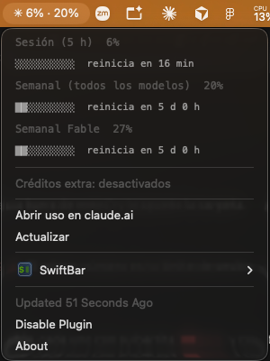

# Usage meter for Claude Code (SwiftBar plugin)

[](https://github.com/Cristopheer96/claude-usage-swiftbar/actions/workflows/ci.yml) [](https://github.com/Cristopheer96/claude-usage-swiftbar/releases/latest) [](LICENSE)

See your Claude plan limits in the macOS menu bar: the 5-hour session limit, the weekly limit and any per-model weekly limit, with time until each one resets.



`✳ 6% · 20%` = session usage · weekly usage. The title turns orange at 70% and red at 90%.

- **Two notifications:** one when your 5-hour session reaches 90% ("Claude: 92% of your session used. Resets at 17:14 (in 1 h 20 min)") and another the moment it resets ("Claude is available again").
- **Rate-limit safe:** if Anthropic answers 429, it keeps showing the last data and waits as told.
- **Updates itself on request:** checks GitHub once a day and adds an "Install update" item when there is a new release.
- English and Spanish, following your macOS language.

> Not affiliated with or endorsed by Anthropic. It reads the same unofficial endpoint the Claude Code `/usage` command uses, so it may break if Anthropic changes it.

## Install

```bash
curl -fsSL https://raw.githubusercontent.com/Cristopheer96/claude-usage-swiftbar/main/install.sh | bash
```

The installer:

1. Installs [SwiftBar](https://swiftbar.app) with Homebrew if you don't have it.
2. Installs `jq` if it's missing (macOS 15+ already ships it).
3. Copies the plugin into your SwiftBar plugin folder (`~/.swiftbar-plugins` if none is set) and starts SwiftBar.

The first time it runs, macOS may ask whether SwiftBar can read the `Claude Code-credentials` Keychain item. Choose **Always Allow**.

Prefer to read it first? Clone the repo and run it locally:

```bash
git clone https://github.com/Cristopheer96/claude-usage-swiftbar.git
cd claude-usage-swiftbar
./install.sh
```

### Requirements

- macOS
- [Claude Code](https://docs.claude.com/en/docs/claude-code) installed and signed in with a Claude subscription (Pro, Max, Team or Enterprise). Run `claude` once and log in.
- Homebrew, only if SwiftBar or `jq` need to be installed.

## Uninstall

```bash
curl -fsSL https://raw.githubusercontent.com/Cristopheer96/claude-usage-swiftbar/main/uninstall.sh | bash
```

This removes the plugin and leaves SwiftBar installed. Remove it with `brew uninstall --cask swiftbar`.

## Settings

Change these in SwiftBar: click the plugin → **SwiftBar** → **Configure Plugin**.

| What | How |
| --- | --- |
| Language | English or Spanish, following your macOS language. `CLAUDE_USAGE_LANG=en` or `es` to force one. |
| Menu bar text | `CLAUDE_USAGE_DISPLAY`: `both` (`✳ 6% · 20%`, default), `session` (`✳ 6%`), `max` (highest limit, `✳ 27%`) or `icon` (`✳ ◔`). |
| Notifications | `CLAUDE_USAGE_NOTIFY_AT`: session % that triggers the warning and the reset alert (default `90`). `0` turns both off. |
| Refresh interval | The `5m` in the file name (every 5 minutes). Going much lower can hit the endpoint's rate limit; the plugin then shows the last data it got. |

## Privacy

- Your token is read from the macOS Keychain entry Claude Code already creates. It is never written anywhere else.
- It is only sent to `api.anthropic.com`, the same host Claude Code talks to.
- The script is a single short bash file: read [`claude-usage.5m.sh`](claude-usage.5m.sh) before installing.

## Troubleshooting

| You see | Meaning |
| --- | --- |
| `✳ ?` | No Claude Code login in the Keychain. Run `claude` and sign in. |
| `✳ ⚠` + error 401 | The token expired. Open Claude Code once and it refreshes it. |
| `⚠ Data from 15:40 (429)` in the menu | Anthropic rate-limited the request. The plugin shows the last data and retries by itself. |
| `✳ ⚠` + another code | The endpoint failed or changed. Open an issue. |
| `↑` next to the numbers | A new version is out. Open the menu → **Install update**. |
| No notifications | They are sent through `osascript`, so allow **Script Editor** in System Settings → Notifications, and check Focus / Do Not Disturb. |
| Nothing in the menu bar | The bar is full and macOS is hiding icons. Quit some apps or hold ⌘ and drag icons to reorder. |

## Development

Run the tests (they also run on every push and PR):

```bash
tests/run.sh
shellcheck claude-usage.5m.sh install.sh uninstall.sh tests/run.sh
```

Render a saved response instead of calling the API:

```bash
CLAUDE_USAGE_FIXTURE=fixtures/near-limit.json ./claude-usage.5m.sh
CLAUDE_USAGE_LANG=es CLAUDE_USAGE_FIXTURE=fixtures/team-with-model-limit.json ./claude-usage.5m.sh
```

`fixtures/` has a normal response, one near the limits, an older response without the `limits` array and an empty one. PRs with fixtures from other plans are welcome. See [CHANGELOG.md](CHANGELOG.md) for releases.

## License

[MIT](LICENSE)

---

## En español

Muestra en la barra de menú de macOS tu uso del plan de Claude: el límite de sesión de 5 horas, el semanal y el semanal por modelo, con el tiempo que falta para cada reinicio.

**Instalar:**

```bash
curl -fsSL https://raw.githubusercontent.com/Cristopheer96/claude-usage-swiftbar/main/install.sh | bash
```

Necesitas tener Claude Code instalado y con la sesión iniciada (`claude`). El idioma sigue al de macOS. Te llega una notificación cuando tu sesión llega al 90 % y otra cuando se reinicia. Todo se configura en SwiftBar → el plugin → **Configure Plugin**:

- `CLAUDE_USAGE_LANG=es` para forzar español.
- `CLAUDE_USAGE_DISPLAY=both|session|max|icon` para elegir qué se ve en la barra.
- `CLAUDE_USAGE_NOTIFY_AT=90` para el porcentaje de los avisos (`0` los apaga).

No es un proyecto oficial de Anthropic.
